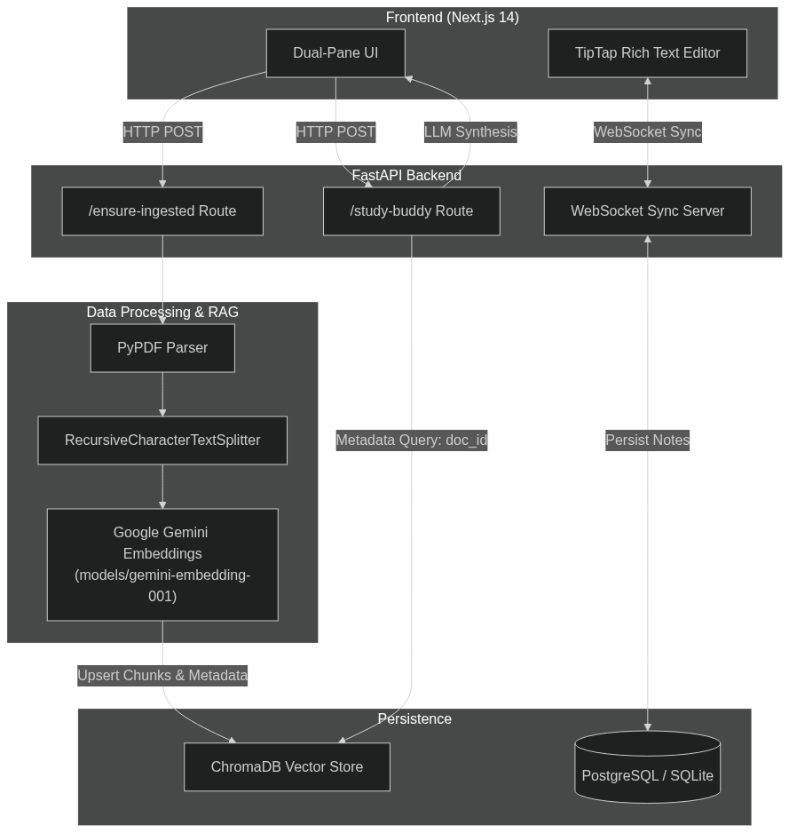

# EKO

EKO is a dual-pane study workspace that combines course document viewing, collaborative note editing, and Gemini-powered retrieval and synthesis. The backend is FastAPI with ChromaDB-backed document ingestion, and the frontend is a Next.js workspace UI.

## Architecture



## What It Does

EKO currently supports:

* Classroom-style document browsing by department, semester, subject, and unit.
* PDF upload and ingestion into ChromaDB for retrieval-augmented answers.
* Real-time collaborative notes over a WebSocket room.
* Gemini-powered study-buddy Q&A and note synthesis.
* Optional peer availability tracking via the matchmaker endpoint.

## Tech Stack

### Frontend

* Next.js 16 with the App Router
* React 19
* TypeScript
* TipTap, React PDF, React Resizable Panels, html2pdf.js, and Lucide React

### Backend

* FastAPI
* SQLAlchemy
* SQLite by default, configurable through `DATABASE_URL`
* ChromaDB for vector storage
* Google Gemini for embeddings and generation
* PyPDF for PDF text extraction

## Project Layout

```text
Eko/
├── backend/
│   ├── app/
│   │   ├── main.py
│   │   ├── database.py
│   │   ├── vector_store.py
│   │   ├── websocket_manager.py
│   │   ├── core/
│   │   ├── models/
│   │   └── routers/
│   ├── chroma_db/
│   ├── req.txt
│   ├── test.py
│   └── test_query.py
├── frontend/
│   ├── app/
│   ├── lib/
│   ├── public/
│   └── package.json
├── uploads/
├── temp_uploads/
└── image.png
```

## Setup

### Prerequisites

* Python 3.10 or higher
* Node.js 18 or higher
* A Google Gemini API key

### Backend

```bash
cd backend

python -m venv venv
venv\Scripts\activate

pip install -r req.txt
```

Create a file named `.env` in `backend/` with:

```env
GEMINI_API_KEY=your_google_gemini_api_key_here
DATABASE_URL=sqlite:///./eko.db
PORT=8000
```

Start the FastAPI server:

```bash
uvicorn app.main:app --reload --port 8000
```

### Frontend

```bash
cd ../frontend
npm install
```

Create a file named `.env.local` in `frontend/` with:

```env
NEXT_PUBLIC_API_URL=http://localhost:8000
```

Start the Next.js development server:

```bash
npm run dev
```

Open `http://localhost:3000/workspace` in your browser.

## API Endpoints

### Authentication

* `POST /api/v1/auth/signup` - Create a new user account
* `POST /api/v1/auth/login` - Log in and receive a bearer token

### Ingestion and Retrieval

* `POST /api/v1/course/ensure-ingested` - Check whether a document is already vectorized and ingest it if needed
* `POST /api/v1/agent/study-buddy/query` - RAG query endpoint for asking questions about course material
* `POST /api/v1/agent/synthesizer/compile` - Turn raw notes into a polished HTML study guide

### Classroom Data

* `GET /api/v1/classrooms/departments`
* `GET /api/v1/classrooms/departments/{department_id}/semesters`
* `GET /api/v1/classrooms/semesters/{semester_id}/subjects`
* `GET /api/v1/classrooms/subjects/{subject_id}/units`
* `GET /api/v1/classrooms/units/{unit_id}/documents`
* `POST /api/v1/classrooms/departments/create`
* `POST /api/v1/classrooms/semesters/create`
* `POST /api/v1/classrooms/subjects/create`
* `POST /api/v1/classrooms/units/create`
* `POST /api/v1/classrooms/units/upload-material`
* `GET /api/v1/classrooms/documents/{document_id}/download` - Stream a stored PDF or return an external link

### Notes and Collaboration

* `POST /api/v1/notes/save`
* `GET /api/v1/notes/{note_id}`
* `WS /api/v1/notes/ws/{room_id}` - Real-time collaborative note editing

### Matchmaker

* `POST /api/v1/agent/matchmaker/toggle` - Update peer availability for a course and detect matches

## Troubleshooting

* If the study buddy returns a model or vector error, confirm `GEMINI_API_KEY` is set and that `vector_store.py` uses the same embedding model expected by the rest of the app.
* If RAG queries return no useful results, confirm the document chunks were ingested with `document_id` in ChromaDB metadata.
* If a PDF ingests as empty text, the file may be scanned-only. The current ingestion path uses `extract_text()`, so OCR would be needed for image-only PDFs.
* If the frontend cannot reach the backend, confirm `NEXT_PUBLIC_API_URL=http://localhost:8000` and that the FastAPI server is running.

## License

Built by Me hehe.